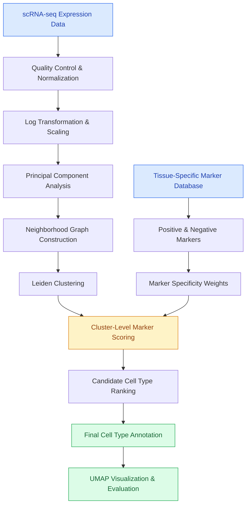

<div align="center">

# 🧬 Cell Type Annotation

### Marker-Based Cell Classification for Single-Cell RNA Sequencing

A Python implementation of ScType-inspired cell type annotation using
**Scanpy, Leiden clustering, and specificity-weighted gene markers.**

[](https://www.python.org/)
[](https://scanpy.readthedocs.io/)
[](https://scikit-learn.org/)

<br>

[](docs/ScType_explanation_implementation.pdf)

<br>

[Overview](#-overview) •
[Methodology](#-methodology) •
[Getting Started](#-getting-started) •
[Project Structure](#-project-structure) •
[References](#-references)

</div>

---

## 🌟 Highlights

- **Automated cell type annotation:** Assigns different cell types to
  clusters using known gene expression markers derived from literature.

- **Positive and negative marker scoring:** Rewards expression of
  more rare genes while 'penalizing' genes that are more common across 
  multiple cell types.

- **Specificity-weighted classification:** Dynamically weights markers
  according to how frequently they appear across candidate cell types to 
  allow certain genes to hold more 'weight'.

- **Tissue-specific marker dictionaries:** Supports configurable marker
  definitions for different tissues and cell populations to improve
  accuracy per sample type.

- **Scanpy-based processing:** Integrates normalization, dimensionality
  reduction, neighborhood graphs, and Leiden clustering.

- **Visualization and evaluation:** Generates annotated UMAP plots and
  compares predictions against reference cell labels.

---

## 🔬 Overview

Single-cell RNA sequencing has been a technology existing for many years.
However, the technology to computationally analyze this type of data is
relatively new. Being able to idenitfy the biological identity of each 
cell computationally has increased productivity of lab ten-fold. 

However, many prediction models fail to gain a high accuracy in comparison 
to wet lab manual sequencing. The process developed by ScType has yielded
accuracy rates much higher than past methods due to the fact that makers were 
made specifically per cell type.

**Cell Type Annotation** explores a programmatic approach to this problem.

Inspired by [ScType](https://github.com/IanevskiAleksandr/sc-type),
an automated cell annotation method originally developed using R and
Seurat, this project implements a marker-based classification workflow
in Python using the Scanpy library instead for my application to 
the Digital Biology Lab at Univeristy of Missouri.

The central idea is pretty straightforward:

> A cell population can be identified not only by the genes it expresses,
> but also by the genes it is expected **not** to express.

By combining positive markers, negative markers, and marker-specificity
weights, the algorithm scores candidate cell types and assigns the
highest-scoring identity to each cluster.

### How it works



---

## 🧪 Methodology

### 1. Data Preprocessing

Raw single-cell gene expression matrices contain thousands of genes
measured across individual cells.

Before annotation, the data undergoes a preprocessing pipeline using
Scanpy and scikit-learn.

**Normalization**

Gene expression counts are normalized to account for differences in
sequencing depth between cells.

```python
sc.pp.normalize_total(adata)
sc.pp.log1p(adata)
```

The logarithmic transformation compresses large expression values:

$$
X'_{ij} = \ln(1 + X_{ij})
$$

where $X_{ij}$ represents the normalized expression of gene $j$ in cell $i$.

**Z Score Normalization**

Expression values are subsequently scaled using a z-scale transformation to represent how likely each expression is to occur in relation to other gene's. 

This transformation is done to allow for relative comparison:

$$
X''_{g,n} = \frac{X'_{g,n} - \mu_g}{\sigma_g}
$$

- $\mu_g$ is the mean expression of gene $g$.
- $\sigma_g$ is the standard deviation of gene $g$.

**Dimensionality Reduction**

Principal Component Analysis (PCA) reduces the dimensionality of
the expression matrix while retaining major sources of variation.

```python
sc.tl.pca(adata)
```

This provides a lower-dimensional representation for downstream
neighborhood graph construction and clustering. This allows for computational tasks to be signficiantly faster as the data is far less complex. PCA was able to reduce almost ~100 dimensions.

### 2. Leiden Clustering

Following preprocessing, the algorithm constructs a neighborhood graph
representing similarities between cells in relation to gene expression.

```python
sc.pp.neighbors(adata, random_state=42)

sc.tl.leiden(
    adata,
    key_added="clustering",
    resolution=0.1,
    flavor="igraph",
    random_state=42
)
```

Leiden clustering identifies communities of transcriptionally similar cells in this graph.

Each resulting cluster is going to represent 
a certain cell type. 

The clustering resolution is a hyper parameter 
that influences the amount of clusters created.
### 3. Dynamic Marker Dictionary

A key component of the project is its configurable marker database.

Marker definitions are loaded from `marker_dictionary.csv` and
organized by tissue, cell type, and marker classification.

Each candidate cell type is associated with two sets of genes:

| Marker Type | Description | Effect on Score |
|---|---|---|
| Positive | Genes expected to be expressed in a cell type | Increase |
| Negative | Genes expected to be absent or weakly expressed | Decrease |

For example, a simplified T-cell marker definition might look like:

While this dicitonary setup is not optimal for larger scale projects this was okay for this project.

```python
marker_dictionary = {
    "T cells": {
        "positive": ["CD3D", "CD3E"],
        "negative": ["CD14"]
    }
}
```

Here, expression of `CD3D` and `CD3E` supports a T-cell classification,
while expression of `CD14` does the opposite and indicates there is a lower chance of a cell being a 'T Cell' if CD14 exists.

The marker dictionary can be modified to incorporate additional
cell types, tissues, and biological markers without changing the
underlying scoring algorithm.

### 4. Marker Specificity Weighting

Not all gene markers are equally informative.

Some genes are associated with many different cell types, while
others are relatively specific to a particular population.

To account for this, the implementation assigns each marker a
specificity weight based on its frequency across candidate cell types.

For a marker $g$:

$$
w_g = \frac{1}{n_g}
$$

where $n_g$ is the number of candidate cell types containing that
marker in the corresponding positive or negative marker dictionary. In lament terms, if the gene appears more it is given less 'weight' using an inverse function.

A gene associated with only one cell type receives a weight of 1.

A gene shared across four cell types receives a weight of 0.25.

This reduces the influence of broadly shared markers and prioritizes
genes that are more discriminative within the configured marker database.

### 5. Cell Type Scoring

For each cluster, the algorithm evaluates every candidate cell type
using its positive and negative marker sets.

Positive marker expression contributes to the classification score,
while negative marker expression is subtracted.

The implemented scoring function can be represented as:

$$
S(c,t) =
\frac{\sum_{g \in P_t} w_g^{+} \bar{x}_{c,g}}{\sqrt{|P_t|}}
-
\frac{\sum_{g \in N_t} w_g^{-} \bar{x}_{c,g}}{\sqrt{|N_t|}}
$$

where:

- $S(c,t)$ is the score for cell type $t$ in cluster $c$.
- $P_t$ and $N_t$ are the available positive and negative markers.
- $\bar{x}_{c,g}$ is the mean expression of gene $g$ across cluster $c$.
- $w_g^{+}$ and $w_g^{-}$ are marker-specificity weights.

The score is normalized by the square root of the number of
available markers in each set.

If no negative markers are available, the negative contribution
is set to zero. Candidate cell types without positive markers
in the dataset are skipped.

**Final Classification**

Each cluster is assigned the candidate cell type with the
highest calculated score:

$$
\hat{t}_c = \underset{t}{\mathrm{arg\,max}} \; S(c,t)
$$

The resulting labels are stored in the AnnData object:

```python
adata.obs["manual_annotations"] = (
    adata.obs["clustering"].map(cluster_annotations)
)
```

This produces an interpretable, marker-based annotation
for each cell cluster.

---

## 📊 Visualization & Evaluation

### UMAP Visualization

The project uses Uniform Manifold Approximation and Projection
(UMAP) to visualize the resulting cell populations.

```python
sc.pl.umap(
    adata,
    color="manual_annotations",
    legend_loc="on data"
)
```

UMAP provides a two-dimensional representation of the data in which
cells with similar expression profiles tend to appear near one another.

The implementation generates plots colored by:

- **Leiden cluster:** The unsupervised community assigned to each cell.
- **Predicted cell type:** The biological identity assigned by the
  marker-based scoring algorithm.

### Classification Evaluation

When ground-truth annotations are available, predicted labels can
be compared with reference cell types.

The implementation uses scikit-learn's classification report:

```python
from sklearn.metrics import classification_report

print(classification_report(actual, predicted))
```

This provides precision, recall, F1-score, and support for the
evaluated cell types.

The repository includes preprocessing scripts for exploring PBMC,
kidney, and prostate datasets.

---

## 🚀 Getting Started

### Prerequisites

The project is written in Python and uses the following primary
dependencies:

- Scanpy
- AnnData
- NumPy
- pandas
- scikit-learn
- igraph
- leidenalg

### Installation

Clone the repository:

```bash
git clone https://github.com/AryanKammili/Cell-Type-Annotation.git

cd Cell-Type-Annotation
```

Create and activate a virtual environment:

```bash
python -m venv .venv

source .venv/bin/activate
```

Install the required libraries:

```bash
pip install scanpy anndata numpy pandas scikit-learn igraph leidenalg
```

### Running the Project

The current implementation consists of separate preprocessing scripts
and a marker-based annotation script.

For the PBMC workflow:

**Step 1 — Prepare the data**

Place the required PBMC expression matrix and reference annotations
at the paths expected by `pbmcData.py`.

Create the output directory:

```bash
mkdir -p pickle
```

Run preprocessing:

```bash
python pbmcData.py
```

This normalizes the expression matrix, performs feature scaling
and PCA, and saves the processed AnnData object.

**Step 2 — Run cell annotation**

```bash
python model.py
```

The annotation script loads the preprocessed PBMC data, constructs
cell neighborhoods, performs Leiden clustering, calculates marker
scores, and generates annotated UMAP plots.

**Note:** The repository currently uses local dataset paths, and the
raw datasets are not included in the tracked repository files.
The input data must be supplied before running the complete workflow.

The current `model.py` is configured for PBMC annotation. Other
tissue workflows require updating the relevant dataset path and
marker dictionary selection.

---

## 📁 Project Structure

```text
Cell-Type-Annotation/
│
├── model.py                 # Marker scoring and cell annotation
├── preprocessing.py         # Marker loading and label utilities
│
├── pbmcData.py              # PBMC preprocessing
├── kidneyData.py            # Kidney dataset preprocessing
├── prostateData.py          # Prostate dataset preprocessing
│
├── marker_dictionary.csv    # Tissue-specific gene markers
├── custom.txt               # Ensembl-to-gene-symbol mapping
│
└── cache/                   # Cached project files
```

### Main Components

| File | Description |
|---|---|
| `model.py` | Performs Leiden clustering, marker specificity weighting, cell type classification, visualization, and evaluation. |
| `preprocessing.py` | Loads tissue-specific markers, maps Ensembl gene IDs to symbols, and provides annotation-label mapping utilities. |
| `marker_dictionary.csv` | Stores positive and negative gene markers for candidate cell types. |
| `pbmcData.py` | Loads and preprocesses peripheral blood mononuclear cell data. |
| `kidneyData.py` | Loads and preprocesses kidney single-cell data. |
| `prostateData.py` | Loads and preprocesses prostate single-cell data. |
| `custom.txt` | Provides gene identifier mappings used during annotation. |

---

## 🛠️ Tech Stack

| Technology | Application |
|---|---|
| **Python** | Core implementation |
| **Scanpy** | Single-cell RNA-seq analysis and clustering |
| **AnnData** | Gene expression data representation |
| **NumPy** | Numerical operations and marker scoring |
| **pandas** | Data manipulation and marker database loading |
| **scikit-learn** | Feature scaling and classification evaluation |
| **Leiden Algorithm** | Graph-based community detection |
| **UMAP** | Low-dimensional visualization |

---

## 🔮 Future Improvements

Potential extensions include:

- **Confidence-based classification:** Introduce score thresholds
  to identify clusters with insufficient evidence for annotation.

- **Expanded marker databases:** Incorporate additional tissues,
  cell populations, and curated gene markers.

- **Improved generalization:** Evaluate marker weighting across
  datasets with different sequencing technologies and cell populations.

- **Benchmarking:** Compare annotation performance against ScType
  and other established cell annotation tools.

- **Reusable API:** Package the annotation algorithm into callable
  functions for integration with existing Scanpy workflows.

---

## 📄 Research & Documentation

This implementation was developed alongside an independent
technical exploration of the ScType algorithm.

My accompanying paper examines:

- The biological principles behind marker-based cell annotation.
- Gene expression normalization and dimensionality reduction.
- Graph-based clustering of single-cell populations.
- Positive and negative marker classification.
- Marker specificity weighting and cell type scoring.

The paper documents the theoretical foundation of the original
ScType framework and the concepts guiding this Python implementation.

**[📄 Read the Full Technical Paper](docs/ScType_explanation_implementation.pdf)**

---

## 📚 References

### Original ScType Research

This project was inspired by the ScType cell annotation framework,
which uses positive and negative gene markers to identify cell
populations from single-cell RNA sequencing data.

**Ianevski et al. — Fully-automated and ultra-fast cell type
identification using specific marker combinations from
single-cell transcriptomic data.**

[Nature Communications — Research Paper](https://doi.org/10.1038/s41467-022-28803-w)

[Original ScType GitHub Repository](https://github.com/IanevskiAleksandr/sc-type)

### Additional Resources

- [Scanpy Documentation](https://scanpy.readthedocs.io/)
- [AnnData Documentation](https://anndata.readthedocs.io/)
- [scikit-learn Documentation](https://scikit-learn.org/)

---

## 👨‍💻 Author

**Aryan Kammili**

University of California, Berkeley

[](https://github.com/AryanKammili)

---

<div align="center">

**Built with Python and Scanpy | Inspired by ScType**

*Exploring computational approaches to single-cell biology.*

</div>